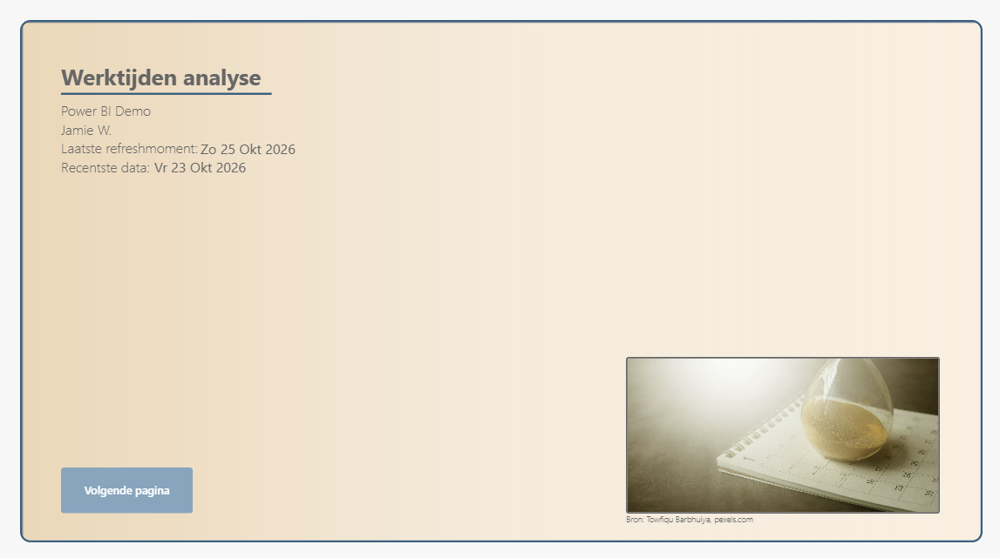
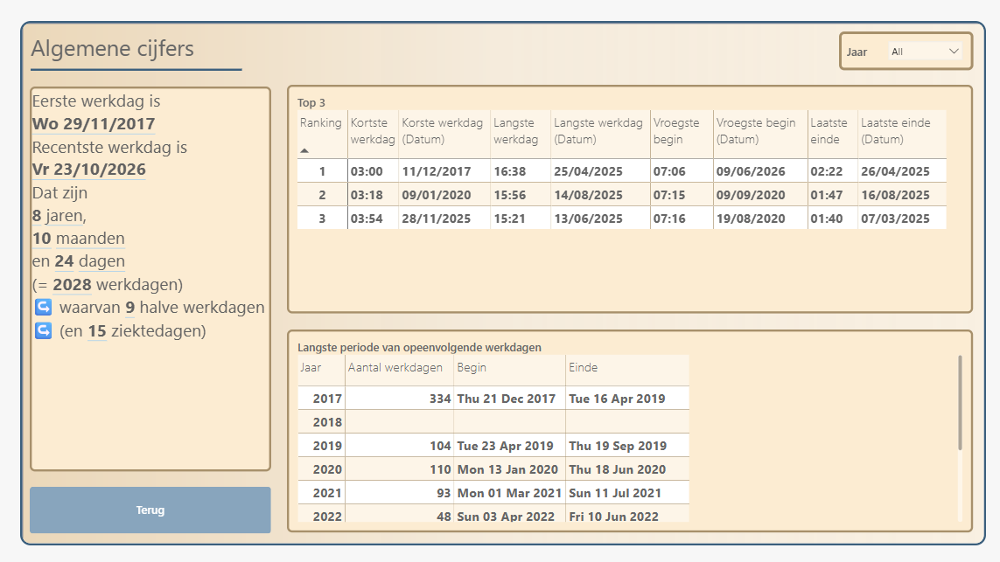
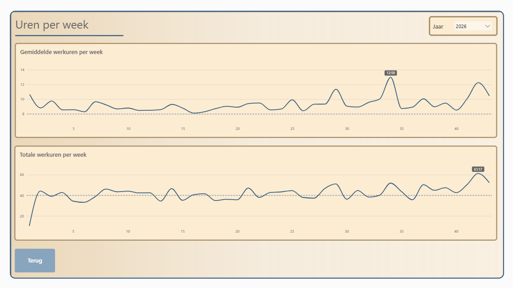
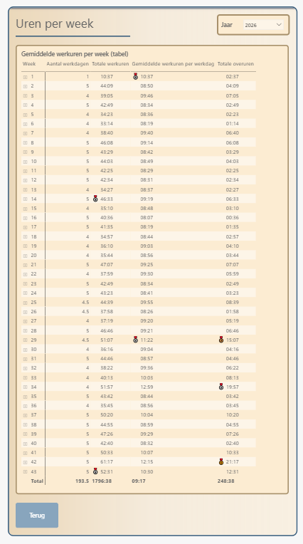
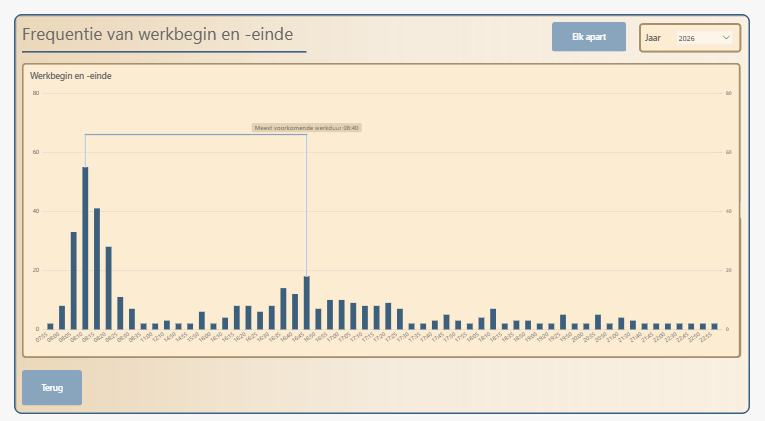

# Werktijden analyse

Een Power BI-rapport waarin ik mijn eigen arbeidstijd analyseer: 
  hoeveel ik werk
  wanneer ik begin en stop
  hoe mijn weken verlopen
  hoe lang mijn langste reeks opeenvolgende werkdagen was. 
De data komt uit mijn eigen login- en loguitregistratie, aangevuld met mijn verlofplanning en de Belgische wettelijke feestdagen

Het project laat vooral zien hoe ik van ruwe data tot een volledig datamodel kom: data ophalen en opschonen in Power Query, modelleren in een star-schema (Kimball model) en berekeningen opbouwen in DAX, inclusief DAX user-defined functions (UDF)

---

## Wat toont het rapport?

Het rapport bestaat uit zes pagina's. De titelpagina en inhoudstafel dienen als navigatie, de andere pagina's zijn bereikbaar via bookmark knoppen

### Algemene cijfers

- **Carrière in een notendop:** eerste en meest recente werkdag, de totale duur in jaren, maanden en dagen, het aantal werkdagen, halve werkdagen en ziektedagen
- **Top 3:** kortste en langste werkdag, vroegste begin en laatste einde, telkens met de datum waarop dat gebeurde
- **Langste workstreak per jaar:** de langste periode van opeenvolgende werkdagen, met begin- en einddatum

### Uren per week (grafiek)

Twee linecharts met de gemiddelde en de totale werkuren per week (weeknr volgens ISO 8601). Hoogste waardes krijgen een label en een stippellijn toont de norm (gemidd. werkduur = 8 uur per dag, 40 uur per week)

### Uren per week (tabel)

Dezelfde data als uren per week, maar in tabelvorm: aantal werkdagen, totale werkuren, gemiddelde per werkdag en totale overuren. De top 3 per kolom wordt gemarkeerd met een custom medaille icoon via cond. formatting.

### Frequentie van werkbegin en -einde

Een histogram van hoe vaak ik in een bepaalde periode van 5 minuten start of stop. Het meest voorkomende beginmoment en eindmoment worden gemarkeerd, samen met de meest voorkomende werkduur. 
Met knop "Elk apart" zijn login en loguit momenten elk afzonderlijk getekend

---

## Databronnen

| Bron | Gebruik |
|------|---------|
| `Login data.csv` | Eigen logins en loguits: datum, tijd, opmerking en thuiswerk-indicator. Eén rij per werksessie |
| `Verlofplanning.xlsx` | Verlofdagen per jaar (één worksheet per jaar), inclusief halve verlofdagen |
| [holidata.net](https://holidata.net) (`nl-BE`) | Wettelijke Belgische feestdagen via een API, per jaar berekend met een Power Query-functie. Alleen feestdagen op weekdagen tellen mee |

> De bestandslocaties staan als parameters in het model (`Login_data_csv` en `Verlof_data_excel`). Pas ze aan naar uw downloadfolder om het rapport te openen en zelf te verversen

---

## Datamodel

Starschema met twee fact tables en twee dim tables.

| Tabel | Type | Rol |
|-------|------|-----|
| `FACT_logindata` | Fact | Eén rij per werksessie, (een dag kan soms meerdere sessies bevatten als ik stop in de namiddag en verder s'avonds werk), werkduur en een check op dagovergang (sessies die na middernacht doorlopen) |
| `FACT_longest_workstreak` | Fact (hulptabel) | Langste reeks opeenvolgende werkdagen per jaar, volledig berekend in Power Query |
| `DIM_date_cal` | Dim | Kalender van 01/01/2017 tot het laatste dag van huidig jaar in de data, met ISO-weeknummer, weekend-, feestdag-, verlof-, halve verlofdag- en ziektedagcheck |
| `DIM_time_cal` | Dim | Tijdsdimensie op minuutniveau met indicatie van huidige 5-min bucket, plus hulpkolommen voor ochtend, kantooruren en avond |
| `_Tbl_measures` | | Lege tabel waarin alle DAX-measures staan, georganiseerd in display folders |
| `disconn_ranking_tbl` | Verborgen Hulptabel | Disconnected table met nummers 1 tem 3 zodat ik top 3 kan tonen |

**Relaties**
- `FACT_logindata[Login_date]` naar `DIM_date_cal[Date]`
- `FACT_logindata[Login_time_ID]` naar `DIM_time_cal[ID]` (actief)
- `FACT_logindata[Logout_time_ID]` naar `DIM_time_cal[ID]` (**inactief**, wordt in DAX geactiveerd met `USERELATIONSHIP` om logouts te tellen)
- `DIM_date_cal[Year]` naar `FACT_longest_workstreak[year]`

Relaties op tijdskolommen zijn niet mogelijk, daarom link ik via een numerieke `ID` in `DIM_time_cal`.

---

## Technische hoogtepunten

### Power Query
- **Feestdagen ophalen via het web:** de functie `FN_get_BE_feestdagen` haalt per jaar de feestdagen op bij holidata.net. Welke jaren nodig zijn, volgt automatisch uit de loginData. Een `try ... otherwise` voorkomt dat een mislukte aanroep de refresh breekt
- **Dynamische kalender:** `DIM_date_cal` bepaalt zelf de begin- en einddatum uit de data en voegt feestdagen en verlof toe met left outer joins
- **Ziektedagen afleiden:** een ziektedag is elke weekdag binnen mijn werkperiode die geen feestdag, verlofdag of gewerkte dag is
- **workstreak in Power Query:** `FACT_longest_workstreak` bepaalt per dag de vorige werkdag en controleert of alle dagen ertussen weekend, feestdag of verlof zijn. Opeenvolgende dagen worden gegroepeerd met `GroupKind.Local`. Een parameter (`Halve_dag_verlof_telt_mee_in_workday_streak`) bepaalt of een halve verlofdag de streak mag onderbreken
- **Sessienummering:** per dag een sessienummer, zodat meerdere in- en uitlogmomenten correct worden verwerkt ingeval een werkdag meerdere sessies bevat
- **ISO-weeknummer** via een eigen functie (`FN_get_iso_week_nr`) berekend bron:https://quanto.eu/determining-iso-week-numbers-in-power-query-is-super-easy/
- Gebruik van `List.Buffer` op plaatsen waar lijsten herhaaldelijk worden gebruikt, voor betere performance

### DAX
- **10 user-defined functions** in plaats van gedupliceerde logica, onder andere:
  - `format_duration`: toont een duur als `[uu]:mm` (al dan niet met een "-" vooraan)
  - `get_ranked_worktime`, `get_ranked_first_login`, `get_ranked_last_logout`: geven de n-de kortste of langste waarde terug, zonder dubbele waarden (ex aequo)
  - `get_worktimes_dates`, `get_first_login_dates`, `get_last_logout_dates`: geven de bijbehorende datums terug
  - `get_min_or_max_over_col`: herbruikbare functie voor min, max en rangschikking over een kolom, die ook de y-assen van de linecharts bepalen zodat ik een beetje bufferruimte heb binnen de chart
- **Duur van de carrière in jaren, maanden en dagen** zonder `DATEDIFF` of `YEARFRAC` voor de jaren, omdat die afwijkende resultaten geven (zie [SQLBI](https://www.sqlbi.com/blog/marco/2018/06/24/correct-calculate-of-age-in-dax-from-birthday/)). De bijbehorende teksten ("jaar" of "jaren") passen zich aan
- **Dynamische y-assen:** aparte measures berekenen minimum en maximum met witruimte, zodat de grafieken altijd mooi uitgelijnd zijn
- **Conditionele opmaak met measures** voor de top 3 per week
- **Meest voorkomende begin- en eindtijd** met `TOPN` en `CONCATENATEX`, inclusief een vaste regel bij gelijke aantallen (vroegste begin, laatste einde)
- Measures staan geordend in display folders (`_format measures`, `_visuals measures`). Tabellen, kolommen en functies zijn gedocumenteerd met beschrijvingen en commentaar

---

## Over de data

De cijfers in het rapport komen uit mijn eigen werktijden.

*Bronnen afbeeldingen titelpagina en inhoudstafel: Towfiqu Barbhuiya en Aboodi Vesakaran, via pexels.com (free to use, royalty free)*
